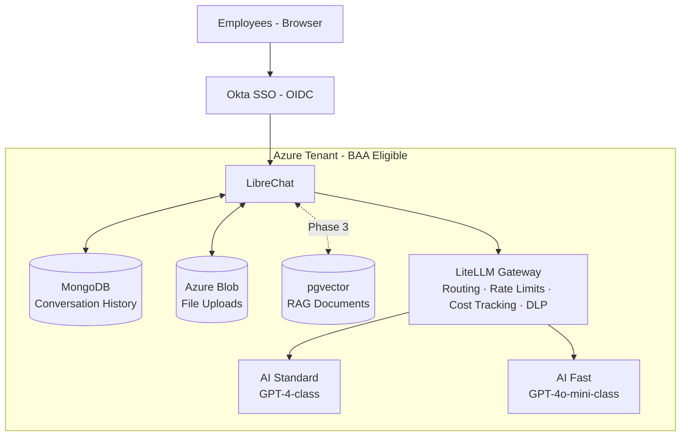

# Internal AI Chatbot

Internal, general-purpose AI assistant for employees — a ChatGPT-style chat application backed by Azure AI Foundry, controlled by a self-hosted LLM gateway, and authenticated through Okta.

## Architecture



All components run inside the company Azure tenant under our existing BAA. No model traffic leaves the Azure backbone.

## Repository Layout

| Directory | Contents |
|---|---|
| `LibreChat/` | LibreChat application source (v0.8.6). Do not edit directly — update via version bumps. |
| `ChatGptForEmployees/` | Phase 0 planning docs, deployment config templates, and validation scripts. |
| `rag_api/` | FastAPI + Langchain RAG service for document retrieval (Phase 3). |
| `pgvector/` | PostgreSQL pgvector extension documentation and setup notes. |

## Getting Started

### Prerequisites

- Docker (local dev) or Azure Container Apps (deployment target)
- Azure OpenAI or Azure AI Foundry endpoint with at least one deployed model
- Node.js v24+ (if running LibreChat locally without Docker)
- Python 3.8+ (for Phase 0 validation scripts)

### Local Development (Docker)

This repo uses git submodules. A plain `git clone` leaves `LibreChat/`, `rag_api/`, `pgvector/`, and `ChatGptForEmployees/` empty. Pull the actual code first:

```bash
git submodule update --init --recursive
```

Then start the app:

```bash
cd LibreChat
cp .env.example .env
# Fill in MONGO_URI, OPENAI_API_KEY (or Azure equivalent), and other required values
docker compose up
```

The app starts at `http://localhost:3080`.

> **Secrets are not in the repo.** You must fill in the `.env` file manually. Contact the project owner for the Azure OpenAI endpoint, keys, and any other credentials needed for your environment.

### Phase 0 Validation Scripts

```bash
cd ChatGptForEmployees
pip install -r scripts/requirements.txt
cp config/azure_openai.env.template scripts/.env
# Fill in Azure OpenAI and LiteLLM values
```

Run in order:

```bash
cd scripts
python validate_azure_openai.py        # Step 1: Azure endpoint health
python validate_litellm.py             # Step 2: LiteLLM container health
python validate_litellm_routing.py     # Step 3: Routing and streaming
python validate_litellm_allowlist.py   # Step 4: Model allowlist
python validate_litellm_usage.py       # Step 5: Usage tracking
python validate_litellm_rate_limits.py # Step 6: Rate limiting
python generate_department_keys.py     # Step 7: Department virtual keys
python validate_department_keys.py     # Step 8: Budget enforcement
```

Each script exits `0` on success, `1` on failure.

> **Windows note:** After any `pip install --upgrade litellm`, re-run `scripts/patch_prisma_windows.py` to restore a Windows-specific fix for LiteLLM startup.

## Configuration

### LibreChat (`LibreChat/.env`)

| Variable | Purpose |
|---|---|
| `MONGO_URI` | MongoDB connection string (Cosmos DB in production) |
| `OPENAI_API_KEY` | Points to the LiteLLM gateway URL + master key, not directly to Azure |
| `OPENID_*` | Okta OIDC configuration (issuer, client ID, client secret) |
| `AZURE_BLOB_*` | Azure Blob Storage for file uploads |
| `RAG_API_URL` | URL of the `rag_api` service (Phase 3) |

Full reference: `LibreChat/.env.example` (1,000+ documented variables).

### LiteLLM (`ChatGptForEmployees/config/litellm.env.template`)

Manages model routing, virtual API keys, rate limits, and cost tracking. Department budgets are defined as `DEPT_<NAME>_BUDGET=<monthly USD limit>` entries and provisioned by `generate_department_keys.py`.

### RAG API (`rag_api/.env`)

Configures the vector store connection (pgvector on PostgreSQL) and embedding model endpoint. Used in Phase 3 when document retrieval is enabled.

## Delivery Phases

| Phase | Scope | Status |
|---|---|---|
| **Phase 0** | POC — validate end-to-end flow, Okta auth, LiteLLM routing, streaming | In progress |
| **Phase 1** | Production pilot — VNet, private endpoints, Key Vault, Cosmos DB, 20–50 users | Planned |
| **Phase 2** | General availability — all employees, staged rollout via Okta groups | Planned |
| **Phase 3** | RAG — curated internal document knowledge base (HR policies, IT docs) | Planned |
| **Phase 4** | Enterprise search across Confluence, SharePoint, Google Drive | Future |

See `ChatGptForEmployees/Erik_recommendation.md` for full architecture rationale and `ChatGptForEmployees/IanTristanCompany_Internal_AI_Chatbot_Phase_0_POC_Plan.md` for Phase 0 acceptance criteria.

## Security and Compliance

- All services hosted in BAA-eligible Azure regions inside the company tenant.
- Inter-service traffic routed over private endpoints — no data traverses the public internet.
- Model provider keys stored in Azure Key Vault; LibreChat never holds raw model credentials.
- Conversation content retention: 90 days default (requires Legal/Compliance sign-off before GA).
- DLP enforcement at the LiteLLM gateway layer via content filtering hooks.
- Audit logs forwarded to Azure Monitor / Log Analytics.

## Operations

- **Cost visibility:** LiteLLM virtual keys issued per department; monthly spend is attributable by org unit.
- **Rate limits:** Per-user daily token soft limits; per-team monthly hard caps; global circuit breaker.
- **Upgrades:** Validate new LibreChat/LiteLLM versions in staging monthly; promote to production quarterly unless a security fix warrants faster movement.
- **Support:** IT helpdesk (Tier 1), internal AI team (Tier 2).

## Contributing

1. Pick up a PBI from the active sprint backlog.
2. Create a branch: `pbi-<id>/<short-description>`.
3. Add or update scripts in `ChatGptForEmployees/scripts/` and templates in `ChatGptForEmployees/config/`.
4. Confirm all existing validation scripts still pass before opening a pull request.
5. Update this README if your change adds a new component or deployment step.

For architecture questions, contact the project owner or refer to the planning documents in `ChatGptForEmployees/`.

## References

- [LibreChat documentation](https://docs.librechat.ai)
- [LiteLLM documentation](https://docs.litellm.ai)
- [Azure OpenAI REST API](https://learn.microsoft.com/en-us/azure/ai-services/openai/reference)
- [Azure Container Apps documentation](https://learn.microsoft.com/en-us/azure/container-apps/)
